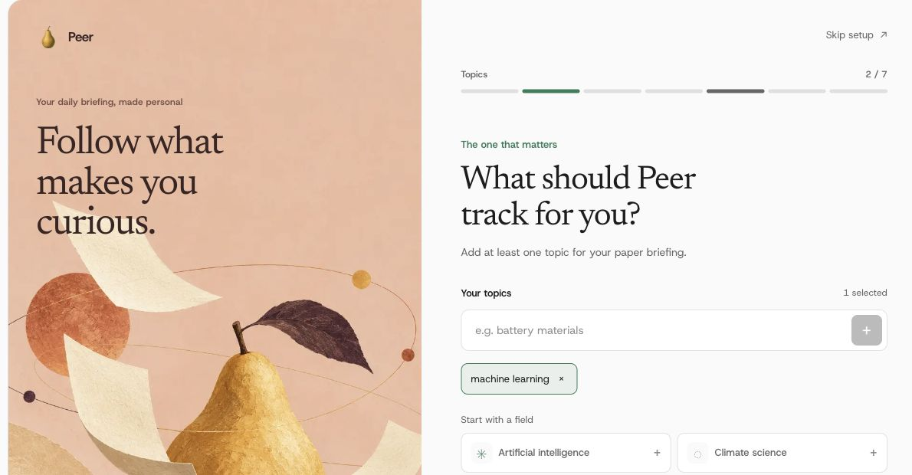
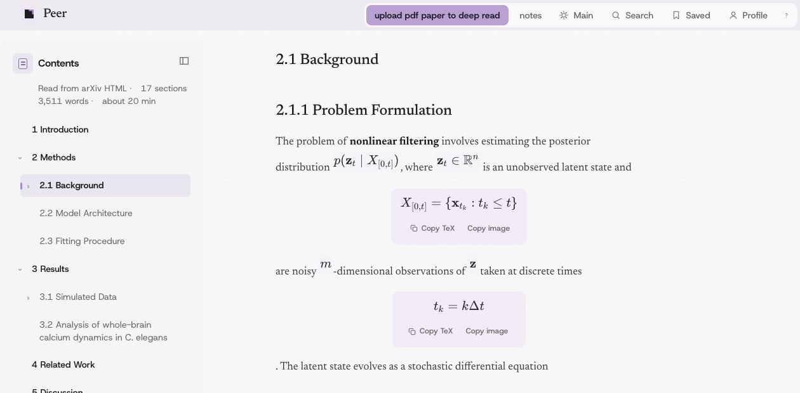
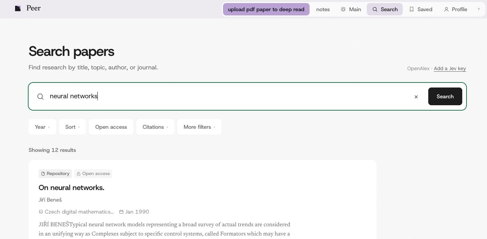

<p align="center">
  
</p>

<h1 align="center">Peer</h1>

<p align="center">A quieter way to keep up with research.</p>

<p align="center">
  <a href="https://peer.homes">Open Peer</a> ·
  <a href="README.zh-CN.md">简体中文</a> ·
  <a href="CONTRIBUTOR_GUIDE.md">Contributor guide</a>
</p>

Peer helps you discover, read, and remember research that matters to you. Start with your interests and let your briefing evolve with your work.

## Start with what matters to you

Choose your topics and research interests to shape a daily briefing. Peer brings together papers from OpenAlex, arXiv, PubMed, Semantic Scholar, DBLP, and other sources.



## Read with context

Navigate a paper by section and read its text, figures, tables, and equations in one place. Highlight passages and collect your thoughts in a dedicated notes workspace. When readable full text is unavailable, follow the link to the source.



<sub>Reader example: [ZENO: Nonlinear filtering with Zakai Equation Neural Operators](https://arxiv.org/abs/2610.32926).</sub>

## Search beyond the briefing

Search by topic, title, author, or venue, then narrow the results with filters.



The core briefing works without an AI key. Optional model features use your own key; availability and results depend on the source and provider.

## Run locally

The main application is in [`web/`](web/). Use Node.js 22 and npm:

```bash
git clone https://github.com/peer-research-project/peer.git
cd peer/web
npm ci
npm run dev -- -p 3001
```

Open [localhost:3001](http://localhost:3001). The basic experience can run without environment variables. For sign-in, persistence, and other integrations, see [`web/.env.example`](web/.env.example). Keep credentials out of the repository.

```bash
npm test
npm run lint
npm run build
```

The separate [`python/`](python/) directory contains the original local-first CLI. Its implementation is independent of the web app.

## Project resources

- [Documentation index](docs/README.md), [product direction](docs/PRODUCT_DIRECTION.md), and [vision](VISION.md)
- [Contributor guide](CONTRIBUTOR_GUIDE.md) and [project rules](AGENTS.md)
- [Contributor license agreement](docs/CLA.md) and [third-party notices](docs/THIRD_PARTY_NOTICES.md)

## License

Copyright © 2026 Baichuan Wang and Xiaoyang Wang. Peer is licensed under [AGPL-3.0-only](LICENSE). Earlier versions released under MIT remain under their original license; third-party components retain their own licenses.
