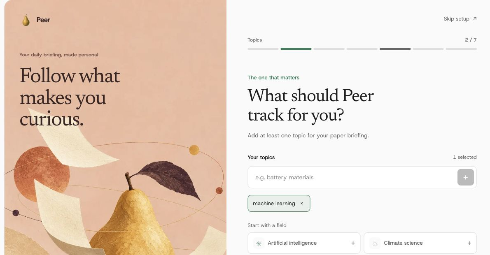
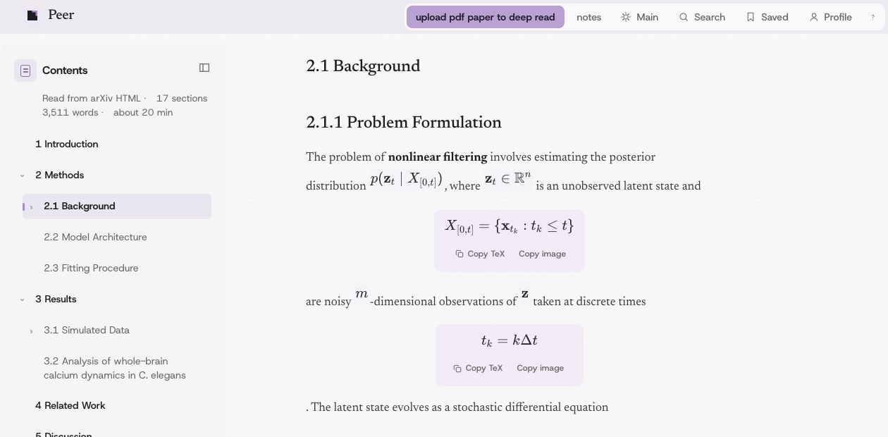
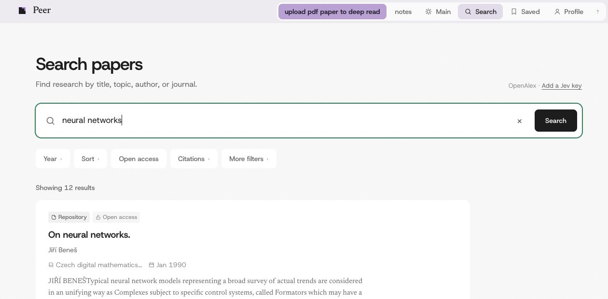

<p align="center">
  
</p>

<h1 align="center">Peer</h1>

<p align="center">让追踪研究进展变得从容。</p>

<p align="center">
  <a href="https://peer.homes">打开 Peer</a> ·
  <a href="README.md">English</a> ·
  <a href="CONTRIBUTOR_GUIDE.md">开发者指南</a>
</p>

Peer 帮你发现、阅读和记录与你相关的研究。从感兴趣的主题开始，让每日简报随研究一起变化。

## 从你关心的问题开始

选择研究主题和兴趣，形成属于你的每日简报。Peer 汇集 OpenAlex、arXiv、PubMed、Semantic Scholar、DBLP 等来源的论文。



## 带着上下文阅读

按章节浏览论文正文、图片、表格和公式。标记段落，在独立的笔记空间整理想法；无法获取可读全文时，可以访问原始来源。



<sub>阅读示例：[ZENO: Nonlinear filtering with Zakai Equation Neural Operators](https://arxiv.org/abs/2610.32926)。</sub>

## 搜索简报之外的研究

按主题、标题、作者或期刊查找论文，再用筛选条件缩小范围。



核心简报无需 AI 密钥即可使用。可选的模型功能使用你自己的密钥；功能可用性和结果取决于来源与服务商。

## 本地运行

主要应用位于 [`web/`](web/)，使用 Node.js 22 和 npm：

```bash
git clone https://github.com/peer-research-project/peer.git
cd peer/web
npm ci
npm run dev -- -p 3001
```

打开 [localhost:3001](http://localhost:3001)。基础功能可以不配置环境变量运行；登录、数据持久化和其他集成的配置参见 [`web/.env.example`](web/.env.example)。不要将密钥提交到仓库。

```bash
npm test
npm run lint
npm run build
```

[`python/`](python/) 中还有最初的本地优先命令行工具，与 Web 应用是独立实现。

## 项目资料

- [文档目录](docs/README.md)、[产品方向](docs/PRODUCT_DIRECTION.md)与[产品愿景](VISION.md)
- [开发者指南](CONTRIBUTOR_GUIDE.md)与[项目规则](AGENTS.md)
- [贡献者许可协议](docs/CLA.md)与[第三方组件声明](docs/THIRD_PARTY_NOTICES.md)

## 许可

版权所有 © 2026 Baichuan Wang 和 Xiaoyang Wang。Peer 使用 [AGPL-3.0-only](LICENSE) 许可。此前以 MIT 许可发布的版本仍适用其原许可；第三方组件各自保留其许可。
